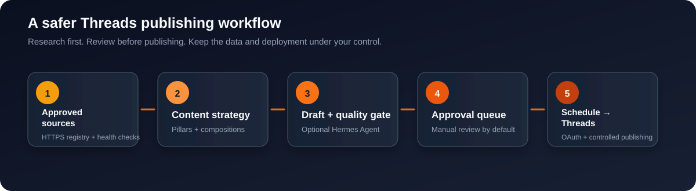
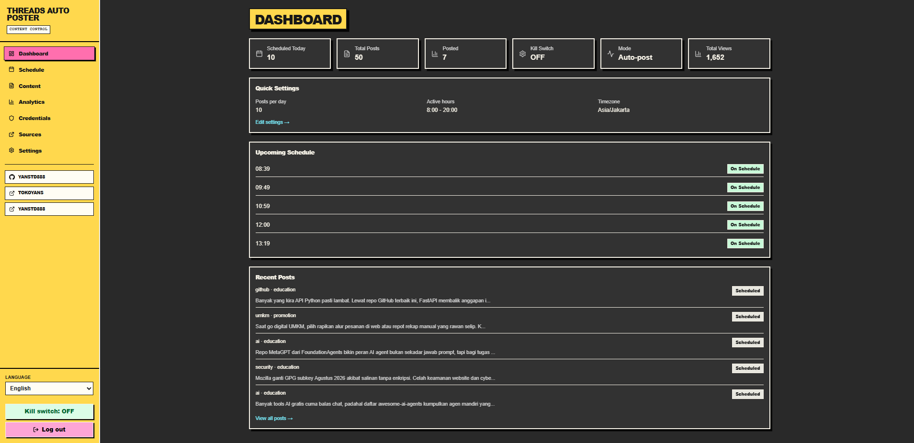
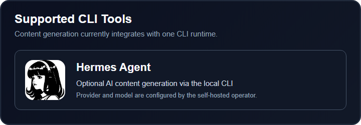

<p align="center">
  
</p>

<h1 align="center">Threads Auto Poster</h1>

<p align="center">
  <strong>Self-hosted Threads scheduling, content research, AI-assisted drafting, approval, and publishing in one private workspace.</strong>
</p>

<p align="center">
  Build a reliable Threads content workflow without handing your sources, drafts, schedule, or publishing controls to a third-party SaaS dashboard.
</p>

<p align="center">
  <a href="https://yanstd888.github.io/threads-auto-poster/">Project site</a> ·
  <a href="#quick-start">Quick start</a> ·
  <a href="#features">Features</a> ·
  <a href="#supported-cli-tools">Supported CLI tools</a> ·
  <a href="#deployment">Deployment</a> ·
  <a href="#safety-model">Safety</a> ·
  <a href="#documentation">Documentation</a>
</p>

<p align="center">
  
  
  
  
  
</p>

<p align="center">
  <a href="https://www.producthunt.com/products/threads-auto-poster/reviews/new?utm_source=badge-product_review&utm_medium=badge&utm_source=badge-threads-auto-poster" target="_blank" rel="noopener noreferrer">
    
  </a>
</p>

---

## Why Threads Auto Poster?

Consistent publishing is difficult when ideas, source links, drafts, approvals, schedules, and publishing credentials are spread across unrelated tools. **Threads Auto Poster** brings those steps together in a self-hosted dashboard built for creators, marketers, developers, and small teams who want a more controlled Threads automation workflow.

Use it as a **Threads content planner**, **source-backed social media scheduler**, **AI-assisted post drafting workspace**, or a lightweight internal publishing console. Start with manual approval, keep the kill switch enabled, and turn on automated publishing only after the complete workflow is verified.

### What makes it different

- **Self-hosted by design** — run the dashboard and SQLite data on your own computer or VPS.
- **Research before writing** — maintain an approved HTTPS source registry and attach source context to content preparation.
- **Human approval first** — drafts are reviewed before publishing by default.
- **AI is optional** — the dashboard, scheduling, sources, backups, and Threads connection can run without the content agent.
- **Operationally boring** — SQLite WAL, backups, config transfer, integrity checks, and scoped Docker commands are included.
- **Manual updates** — the dashboard can notify users when a newer GitHub Release is available without overwriting the running installation.

## Product preview

The main product interface is the authenticated **Threads Auto Poster dashboard**, where operators manage schedules, content, analytics, credentials, sources, settings, and the kill switch from one workspace.

<p align="center">
  
</p>

<p align="center"><sub>Threads Auto Poster dashboard preview.</sub></p>

## Features

### Content research and planning

- Approved HTTPS source registry with search, filters, health checks, import, and export.
- Content pillars with active-weight normalization to a total of 100%.
- Content compositions for hook, structure, CTA, source-link, language, and length rules.
- Source-aware content preparation with fallback and retry classification.
- Repository-required pillars try other approved GitHub repositories when one source is temporarily unavailable; they still fail closed when no valid repository remains.
- Post history and audit records for operational review.

### Threads content workflow

- Draft, review, approve, schedule, and publish from one dashboard.
- Standalone posts are the default composition mode.
- Configurable posts per day, active hours, timezone, active days, and minimum gaps.
- Approval mode and kill switch protect the first installation.
- Threads OAuth connection with encrypted token storage in SQLite.

### Threads Reply Agent

- Optional reply discovery, draft generation, review, approval, publishing, analytics, and audit trail in **Dashboard → Replies**.
- Disabled by default; publishing stays approval-only until an operator explicitly enables the agent and auto mode.
- Per-account policy is configurable: `once` allows one durable reply per target account; `continuations_only` permits later replies only when that same account directly replies to one of this account's recorded replies.
- Reply publishing uses an atomic claim, rechecks limits after the claim, verifies the published reply, and never blindly retries `publish_unknown`.
- Keyword search and profile discovery depend on Meta app capability and OAuth permission. The UI reports the official API result; it does not scrape Threads or use browser automation.

### AI-assisted content generation

- Optional Hermes Agent CLI integration.
- Provider and model are operator-configurable.
- Readiness preflight prevents avoidable agent failures.
- Empty or malformed agent output is rejected instead of being scheduled as content.
- Retryable source and agent failures can retry until the slot horizon; unknown publish results are not blindly retried.

### Self-hosting and operations

- Native Node.js deployment for installations that need Hermes Agent.
- Docker Compose deployment for the dashboard, SQLite, scheduler, token storage, and Threads publishing.
- SQLite WAL mode, foreign keys, busy timeout, integrity checks, and backup/restore scripts.
- One admin account with HTTP-only session cookies and login rate limiting.
- Strict production security headers and environment-aware CSP.

## How it works

```text
Approved HTTPS sources
        │
        ▼
Content pillars + compositions
        │
        ▼
Hermes Agent CLI (optional)
        │
        ▼
Draft + quality checks
        │
        ▼
Approval queue ──► Schedule ──► Threads API
```

The content agent is not required for the core product. You can use the source registry, dashboard, scheduling controls, backups, and Threads connection without installing Hermes Agent.

## Supported CLI Tools

Threads Auto Poster currently supports **Hermes Agent** as its CLI content-generation runtime. More integrations should only be added when they have a tested command contract, readiness check, timeout policy, and safe failure behavior.

<p align="center">
  
</p>

### Hermes Agent setup

Install and configure Hermes Agent as the same operating-system user that runs Threads Auto Poster. Verify the exact provider and model before saving them in the dashboard:

```bash
printf 'Return exactly: HERMES_OK' | hermes chat --query-file - --oneshot --quiet --cli --provider YOUR_PROVIDER -m YOUR_MODEL
```

The command must print `HERMES_OK`. Then configure the matching provider and model in **Pengaturan / Settings** and enable the Content Agent.

`THREADS` is an example model name used by some operator configurations. It is valid only when the selected Hermes provider defines that model or alias.

> Hermes Agent is optional for the public Docker image. The stock image does not bundle the Hermes binary; use native Node.js deployment or provide the CLI inside your own image when AI generation is required.

## Quick start

### 1. Clone the repository

```bash
git clone https://github.com/yanstd888/threads-auto-poster.git
cd threads-auto-poster
```

### 2. Create a local environment

```bash
cp .env.example .env.local
```

Set real local values before starting the app. At minimum, use a strong `ADMIN_PASSWORD`, a random `JWT_SECRET`, and a separate `TOKEN_ENCRYPTION_KEY`. Never commit `.env.local`.

### 3. Install and start

```bash
npm ci
npm run dev
```

Open the URL printed by Next.js, then follow the safe first-run sequence:

1. Sign in with the admin password.
2. Leave **Posting Mode** on **Draft / approval required**.
3. Keep the **Kill Switch** enabled.
4. Add approved sources in **Sources / Sumber**.
5. Configure content pillars and compositions.
6. Verify Hermes Agent before enabling the Content Agent.
7. Connect Threads only after the public HTTPS callback is ready.

For the complete setup order, read [Getting Started](docs/GETTING_STARTED.md).

## Configuration

The release uses neutral public defaults:

```text
timezone=UTC
hermes_provider=openai-compatible
hermes_model=default
threads_username=@your_threads_username
posting_mode=approval
kill_switch=true
content_agent_enabled=false
```

These defaults are deliberately safe for a fresh clone. Production operators can configure their own provider, model, account, timezone, and publishing mode after verifying the complete environment.

## Deployment

### Native Node.js

Native deployment is the recommended path when Hermes Agent runs on the same operating-system user as the app:

```bash
npm ci
npm run build
npm run start
```

Keep the application behind HTTPS and a controlled access layer when exposing it remotely. The app itself should remain bound to a private interface or loopback where practical.

### Docker Compose

```bash
cp .env.example .env
# edit .env; never commit it
docker compose -f compose.yaml up -d --build
```

Docker Compose persists the app data outside the image and supports the dashboard, scheduler, SQLite, token storage, and Threads publishing. The stock image does not include Hermes Agent, so AI content generation requires a custom image or native deployment.

Stop only this project:

```bash
docker compose -f compose.yaml down
```

Do not use broad process commands such as `taskkill /F /IM node.exe` on a machine that hosts other local services.

## Threads connection

To publish to Threads, create a Threads app in Meta for Developers, configure the exact callback URL, and store the matching value in `THREADS_OAUTH_REDIRECT_URI`:

```text
https://your-domain.example/api/auth/threads/callback
```

Use **Credentials / Kredensial → Connect Threads** to complete OAuth. The returned token is encrypted before it is stored in SQLite. The normal connect flow requests the base publishing scopes.

For Reply Agent discovery, use **Reconnect** from Credentials or the explicit URL below so OAuth requests the optional discovery scopes:

```text
https://your-domain.example/api/auth/threads/connect?reply=1
```

Meta must also grant Keyword Search/Profile Discovery capability to the same app and testing account. A successful reconnect can enable reply publish/quota while discovery remains unavailable; use **Dashboard → Replies → Probe capability** to see the official result. The Credentials page also provides **Disconnect** to remove only the local encrypted token before connecting a different account; it does not revoke the token at Meta.

Live Threads posting is intentionally not part of automated repository acceptance. Test with approval mode and an account you control before enabling automatic publishing.

## Backup and restore

Create a consistent SQLite backup while the app is running:

```bash
THREADS_DATA_DIR=./data BACKUP_DIR=./backups bash scripts/backup.sh
```

Restore only after stopping the app and checking the selected backup:

```bash
docker compose -f compose.yaml stop app
THREADS_DATA_DIR=./data RESTORE_CONFIRM=YES bash scripts/restore.sh ./backups/app-YYYYMMDDTHHMMSSZ.db
```

Keep `.env.local`, `data/`, and backups outside Git. The restore path requires explicit confirmation, checks SQLite integrity, and removes stale WAL sidecars.

## Safety model

- Approval mode is the default posting mode.
- The kill switch is enabled for a new public clone.
- Standalone posts are the default composition mode.
- Source URLs must use HTTPS and cannot point to localhost, private, or link-local addresses.
- Generated content must cite approved sources and pass quality checks before scheduling or publishing.
- A `publish_unknown` result is not auto-retried because the platform may already have accepted the post.
- Reply Agent defaults to disabled and approval-only. Raising a daily account limit does not bypass the configured per-account reply policy.
- Discovery remains disabled by capability when Meta rejects its official API permission; no scraping or browser automation fallback is used.
- Config export excludes tokens, password hashes, users, kill-switch state, history, generated posts, and runtime database rows.
- The dashboard never performs a destructive self-update from a browser request.
- Public release defaults do not contain production credentials, private endpoints, account secrets, or runtime databases.

## Updating from GitHub

The dashboard displays the installed version and checks the public GitHub Releases feed. If a newer release exists, it shows a notification with a link to the release page.

Updates are manual and reviewable:

```bash
# Back up SQLite first, and keep .env.local/data/backups outside Git
git fetch origin --tags
git checkout main
git pull --ff-only origin main
npm ci
npm run build
```

Then restart the service using the process manager for your deployment. Review the release notes before updating production, and keep the previous release available for rollback.

## Documentation

| Guide | Use it for |
| --- | --- |
| [Getting Started](docs/GETTING_STARTED.md) | First install, secrets, admin login, Hermes Agent, Meta Threads, OAuth, publishing, and backups |
| [Setup](SETUP.md) | Environment variables and deployment details |
| [Open-source readiness](docs/OPEN_SOURCE_READINESS.md) | Release gates, supported boundaries, and verification evidence |
| [Open-source plan](docs/OPEN_SOURCE_PLAN.md) | Product scope and release plan |
| [Changelog](CHANGELOG.md) | Version history and notable changes |

## Verification

Run the same checks used for a clean release clone:

```bash
npm ci
npm run lint
npx tsc --noEmit --pretty false
npx tsx check-content-and-schedule.ts
npm audit --omit=dev --audit-level=high
npm run build
git diff --check
```

## Contributing

Issues and pull requests are welcome. Keep changes small, document behavior that affects self-hosting or publishing safety, and include a focused regression check for new parsing, scheduling, retry, security, or data-transfer behavior.

Do not include real `.env` files, SQLite databases, OAuth tokens, provider credentials, private URLs, or personal account data in issues and pull requests.

## License

Apache-2.0. See [LICENSE](LICENSE) and [NOTICE](NOTICE).

## Disclaimer

Threads is a trademark of Meta Platforms, Inc. This project is an independent open-source tool and is not affiliated with, endorsed by, or sponsored by Meta Platforms, Inc.
